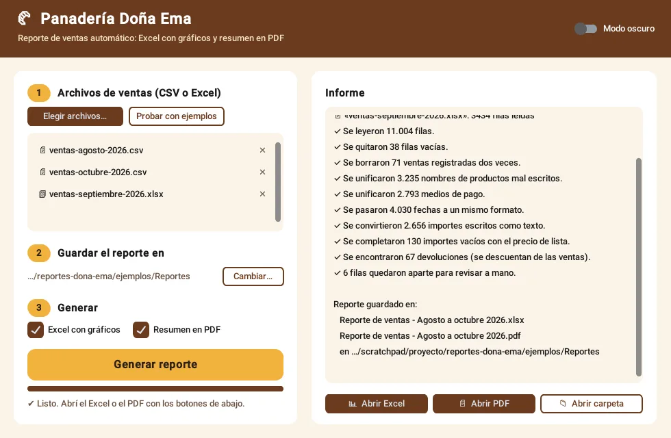
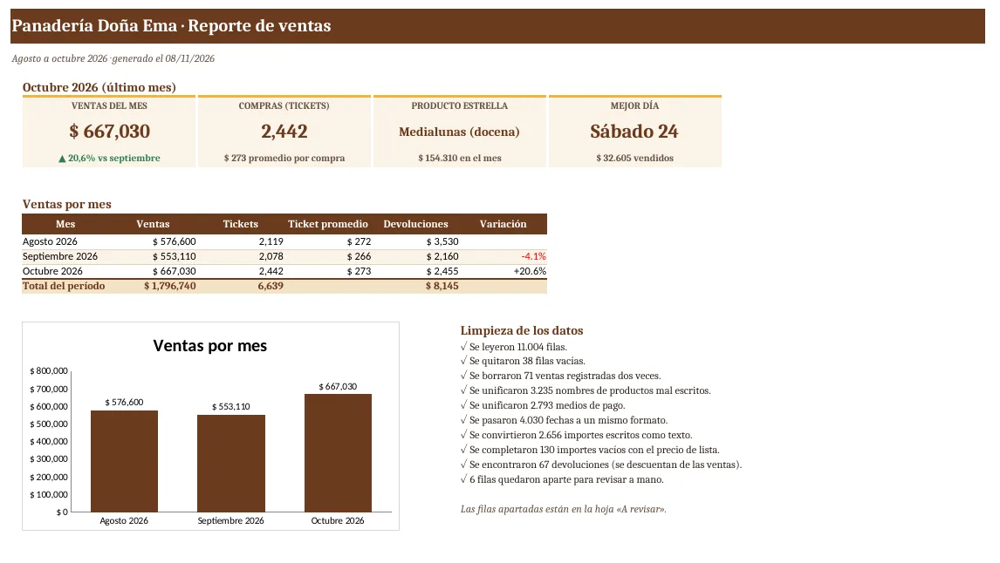
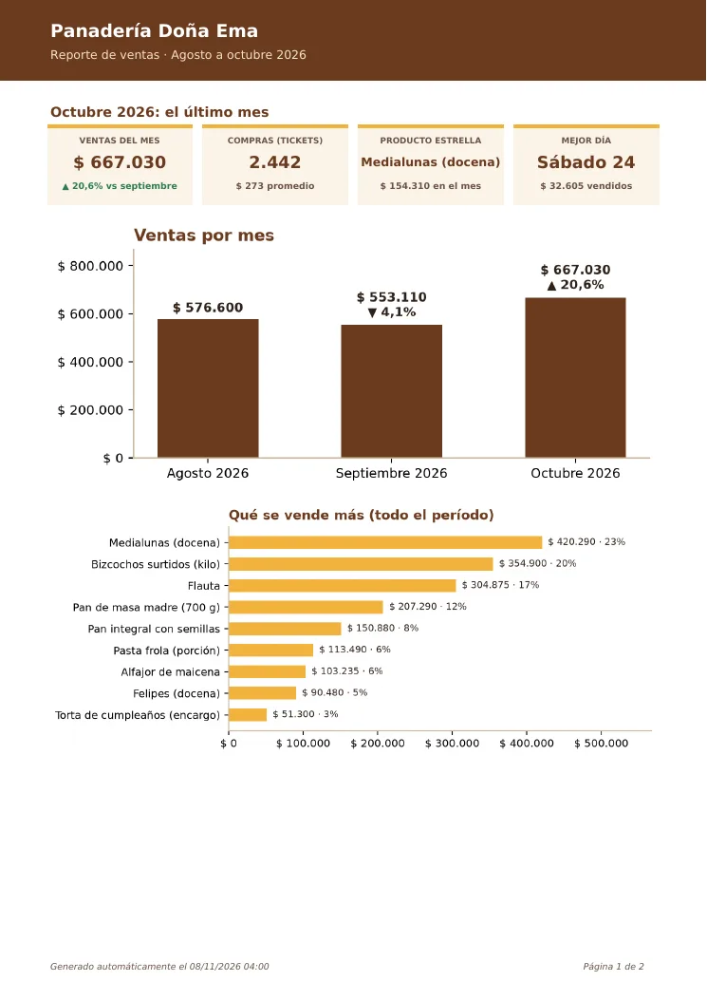
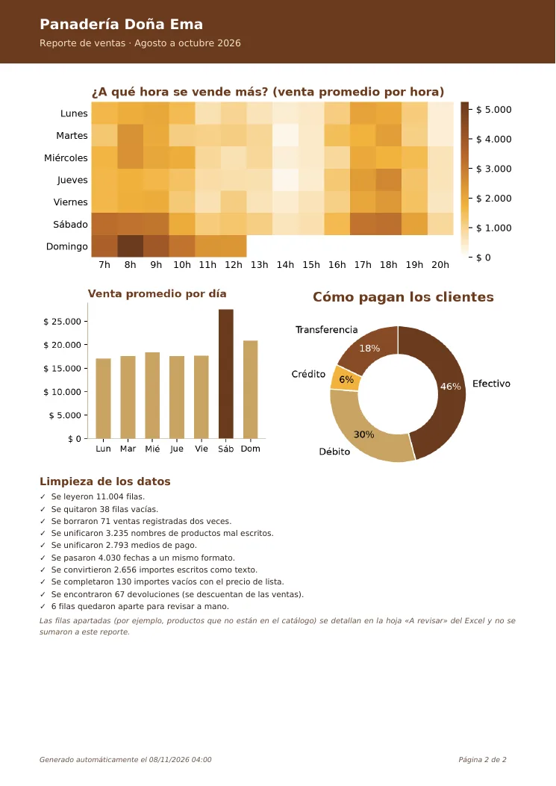
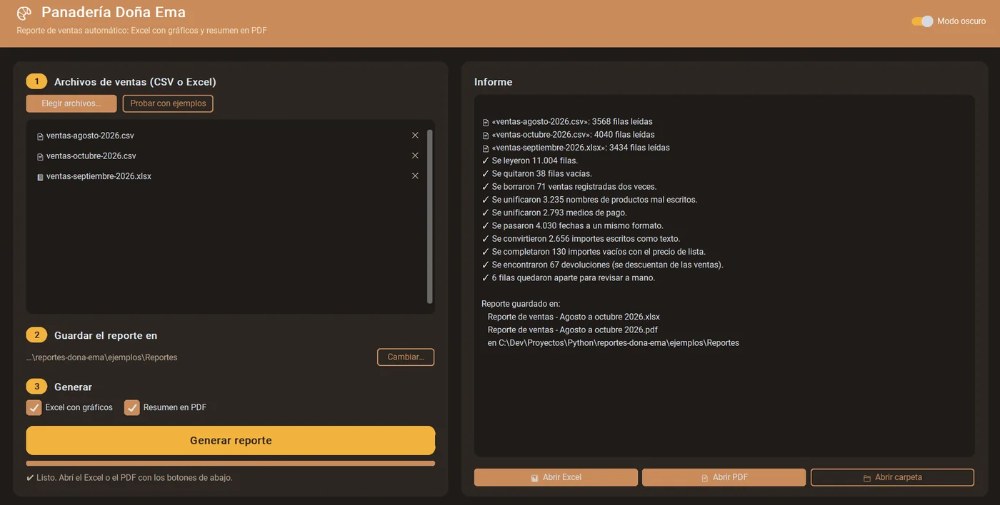

# Reporte de ventas automático · Panadería Doña Ema

Programa de escritorio en Python que toma los archivos de ventas que exporta la caja de un negocio (CSV o Excel, aunque vengan desordenados), los limpia solo y genera en segundos un **Excel con gráficos** y un **resumen en PDF**.



> Proyecto de demostración para mi portafolio. La panadería es la misma de mi [landing de Doña Ema](https://fabricioruy-rdig.github.io/panaderia-dona-ema/); los datos de ventas son ficticios.

## El problema que resuelve

Todos los meses, alguien pasa horas armando el reporte de ventas a mano: copiar, corregir nombres, sumar, hacer gráficos. Y los archivos de la caja nunca vienen prolijos:

- el mismo producto escrito de mil formas (`Medialunas`, `MEDIALUNAS (DOCENA)`, `medialuna x docena`, `Medialunass`);
- fechas e importes en distintos formatos (`03/10/2026`, `2026-10-03`, `$ 1.200`, `0,5`);
- filas vacías, ventas registradas dos veces y devoluciones;
- cada versión del sistema de caja exporta con columnas distintas o con títulos arriba de la tabla.

Este programa lo resuelve con tres clics.

## Qué hace

1. **Lee** uno o varios archivos (varios meses juntos), detecta solo dónde empieza la tabla y qué es cada columna.
2. **Limpia** los datos y **cuenta todo lo que corrigió**. Lo que no puede decidir (por ejemplo, un producto que no está en el catálogo) no lo inventa: lo aparta para revisar a mano.
3. **Genera el Excel**, con 6 hojas:
   - **Resumen:** tarjetas del último mes, comparación con el mes anterior y ventas por mes.
   - **Productos:** ranking con gráfico.
   - **Días y horarios:** mapa de calor de cuándo se vende más.
   - **Medios de pago.**
   - **Ventas limpias:** con filtros.
   - **A revisar.**
4. **Genera el PDF**: un resumen de 2 páginas para imprimir o mandar por WhatsApp.



| Página 1 del PDF | Página 2 del PDF |
|---|---|
|  |  |

Podés descargar los reportes de ejemplo: [Excel](muestras/reporte-ejemplo.xlsx) · [PDF](muestras/reporte-ejemplo.pdf).

## Cómo usarlo

Requiere Python 3.10 o superior.

```bash
python -m venv .venv
.venv\Scripts\python -m pip install -r requirements.txt     # en Windows
.venv\Scripts\python app.py
```

En la ventana, **«Probar con ejemplos»** carga 3 meses de ventas de prueba (de 3 «sistemas de caja» distintos).

También funciona sin ventana, desde la consola, para automatizarlo:

```bash
python -m reportes.generar ejemplos/ventas-agosto-2026.csv ejemplos/ventas-septiembre-2026.xlsx
```

## Cómo está hecho

| Archivo | Qué hace |
|---|---|
| `reportes/negocio.py` | Catálogo de productos, precios y colores. **Es lo único que se cambia para adaptarlo a otro negocio.** |
| `reportes/leer.py` | Lee CSV y Excel, detecta separadores, títulos y nombres de columnas. |
| `reportes/limpiar.py` | Unifica productos (también con errores de tipeo), fechas, importes y medios de pago; quita duplicados y vacías. |
| `reportes/analizar.py` | Totales por mes, producto, día de la semana, hora y medio de pago (pandas). |
| `reportes/excel.py` | El Excel con formato y gráficos nativos (openpyxl). |
| `reportes/pdf.py` | El PDF con gráficos (matplotlib + fpdf2). |
| `reportes/ventana.py` | La interfaz (customtkinter), con modo claro y oscuro; el trabajo corre en un hilo aparte para que no se congele. |
| `herramientas/crear_ejemplos.py` | Genera los archivos de ventas de ejemplo, con errores a propósito. |



## Tecnologías

Python · pandas · openpyxl · matplotlib · fpdf2 · customtkinter

---

**EN:** Desktop app in Python that turns messy sales exports (CSV/Excel) from a point-of-sale system into a formatted Excel report with native charts and a 2-page PDF summary. It cleans inconsistent product names (fuzzy matching), mixed date and amount formats, duplicates and blank rows, and reports every fix it made. Portfolio demo project for a fictional bakery in Montevideo, Uruguay.

Diseño y desarrollo: [fabricioruy-Rdig](https://github.com/fabricioruy-Rdig)
